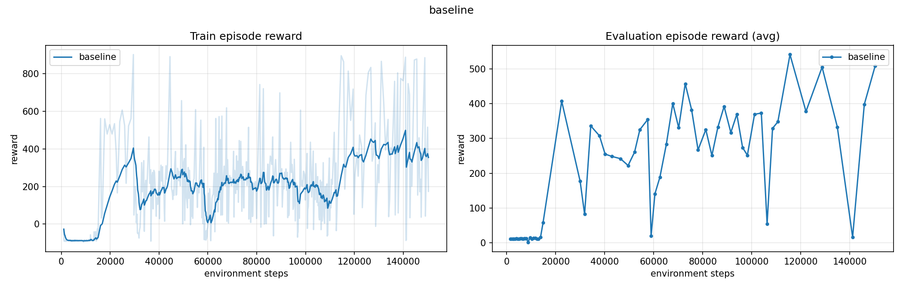
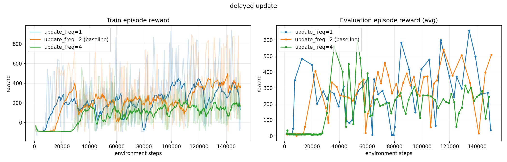

# Reinforcement Learning Project: TD3 for Vision-Based Continuous Control

This project implements **TD3 (Twin Delayed Deep Deterministic Policy Gradient)** in PyTorch and trains it on
`CarRacing-v2`, a car-driving task where the agent sees only the camera image. Its continuous action is
**steer ∈ [-1, 1], gas ∈ [0, 1], brake ∈ [0, 1]**.

It also includes an **ablation study** of TD3's three main components (twin Q-networks, target policy smoothing
and delayed policy updates), of the exploration-noise level and of **reward shaping**. Each switch is a
command-line flag.



## Highlights

- **TD3 from scratch**: clipped double-Q learning, delayed actor and target updates, target policy smoothing,
  and soft (Polyak) target updates.
- **Vision-based control**: 4 stacked 96×96 grayscale frames go into a CNN actor and a CNN critic.
- **Ablation switches**: each TD3 component can be turned off on its own, so its effect can be measured.
- **Reward shaping**: an off-track early-termination rule, plus optional penalties for driving on grass,
  steering jitter and taking sharp turns at high speed.
- **Tooling**: a script that reads the TensorBoard logs and draws comparison plots and a summary table, and a
  demo script that records videos of the trained policy.

## Method

| Component | Implementation |
|---|---|
| Actor | 6 conv layers (ELU, max-pool) → MLP with LayerNorm → `tanh`, rescaled to the valid range of each action dimension |
| Critic (×2) | Same conv encoder for the state, an MLP for the action, concatenated → MLP → Q(s, a) |
| Target | `y = r + γ (1 − done) · min(Q1'(s', ã), Q2'(s', ã))`, where `ã = clip(μ'(s') + clip(ε, −c, c))` |
| Actor update | Every `update_freq` critic updates, maximize `Q1(s, μ(s))` |
| Exploration | Gaussian noise whose σ decays linearly from `sigma_max` to `sigma_min`. The brake noise is scaled down to match the brake's narrow output range |
| Environment wrapper | Grayscale conversion, 4-frame stacking, and road/grass pixel counting under the car for the off-track rule and reward shaping |

Main hyperparameters: γ = 0.99, τ = 0.005, batch size = 32, actor and critic learning rate = 4.5e-5,
replay buffer = 5000, `update_freq` = 2, smoothing σ = 0.2 (clip 0.5), exploration σ_max = 0.1.

## Results

All runs use **150k environment steps and a single random seed**. Evaluation is the average of 10 deterministic
episodes, run every 10 training episodes.

**Final policy (baseline):** average score **548.5** over 10 test tracks (seeds 0–9). The best episodes score
above 800 ([test log](results/test_results.png)).

| Run | Change from the baseline | Best eval | Last eval |
|---|---|---:|---:|
| `baseline` | full TD3 | 541.3 | 508.0 |
| `single_q` | one critic, no clipped double-Q | 561.0 | 520.3 |
| `no_smoothing` | no target policy smoothing | 778.1 | 536.6 |
| `delay1` | `update_freq = 1` (no delay) | 659.5 | 38.0 |
| `delay4` | `update_freq = 4` | 596.7 | 246.2 |
| `sigma0.03` | exploration σ_max = 0.03 | 729.8 | 431.8 |
| `sigma0.3` | exploration σ_max = 0.3 | 701.8 | 162.7 |
| `custom_reward` | grass and steering-jitter penalties | 674.9 | 346.7 |

### Findings

- **Delayed policy updates showed the clearest trend.** Without a delay (`update_freq = 1`) the agent learns
  fastest at first, but late in training the evaluation score collapses to about 38. With `update_freq = 4` the
  agent is stable but learns slowly and plateaus lower. The default of 2 sits between the two.
- **Twin Q-networks:** the single-critic run had lower training reward in the middle of training (about 30k–110k
  steps), which fits the overestimation explanation. The final scores of the two runs are similar.
- **Target policy smoothing** did not show a consistent benefit here. The run without smoothing was even better
  in the middle of training. One possible reason is that σ = 0.2 is a large perturbation for steering, which is
  very sensitive in this task.
- **Exploration noise:** a larger σ found good behaviours earlier but was the least stable late in training. Too
  small a σ caused long periods stuck in the same failure mode.
- **Reward shaping:** the custom reward reached a higher best evaluation score but a lower final one, so it was
  not a clear improvement.

> **Limitation:** each setting was run with one seed, and the evaluation score is noisy. The differences above are
> trends from single runs, not statistically significant results. Running several seeds and reporting mean ± std is
> the obvious next step.

Comparison plots: [twin Q](results/1_twin_q.png) · [target smoothing](results/2_target_smoothing.png) ·
[delayed update](results/3_delayed_update.png) · [action noise](results/4_action_noise.png) ·
[reward function](results/5_reward_function.png)



## Repository structure

```
src/
├── main.py                       # training entry point and ablation flags
├── td3_agent_CarRacing.py        # TD3 agent: action selection, critic and actor updates
├── base_agent.py                 # training and evaluation loop, target updates, checkpoints, noise
├── models/CarRacing_model.py      # CNN actor and critic
├── environment_wrapper/
│   └── CarRacingEnv.py           # preprocessing, frame stacking, off-track rule, reward shaping
├── replay_buffer/replay_buffer.py
├── plot_results.py               # TensorBoard logs → comparison plots and summary.csv
└── demo.py                       # run a checkpoint and record videos
results/                          # plots and summary from the runs above
```

## Setup

The code uses the older `gym` 0.26 API (not `gymnasium`), so Python 3.10 is recommended. `gym[box2d]` needs
`swig` to build Box2D.

```bash
pip install -r requirements.txt
```

## Usage

All commands are run from `src/`. Use a different `--logdir` for each experiment.

```bash
# baseline (full TD3)
python main.py --logdir log/CarRacing/baseline/ --steps 150000

# ablations
python main.py --no-twin                 --logdir log/CarRacing/single_q/      --steps 150000
python main.py --no-smoothing            --logdir log/CarRacing/no_smoothing/  --steps 150000
python main.py --update-freq 1           --logdir log/CarRacing/delay1/        --steps 150000
python main.py --update-freq 4           --logdir log/CarRacing/delay4/        --steps 150000
python main.py --sigma-max 0.03          --logdir log/CarRacing/sigma0.03/     --steps 150000
python main.py --sigma-max 0.3           --logdir log/CarRacing/sigma0.3/      --steps 150000
python main.py --reward-mode custom      --logdir log/CarRacing/custom_reward/ --steps 150000
```

Two more reward variants are implemented but were not part of the runs above:

- `--reward-mode custom_b`: a softer grass penalty that only counts grass above a threshold, with no jitter penalty.
- `--reward-mode custom_bc --speed-safe <v>`: `custom_b` plus a penalty for steering hard above speed `v`.
  `v` has no tested default. A starting point is about half of the car's top speed on a straight, which the
  wrapper reports as `info["speed"]`.

Plot the results and evaluate a checkpoint:

```bash
python plot_results.py --logroot log/CarRacing      # writes log/CarRacing/plots/*.png and summary.csv
tensorboard --logdir log/CarRacing
python demo.py --model log/CarRacing/baseline/<checkpoint>.pth --seed 0 --episodes 10 --name test
```

Checkpoints are saved during training as `model_<step>_<eval score>.pth` in the log directory. They are not
included in this repository.

On a headless machine (for example Colab), set `SDL_VIDEODRIVER=dummy` before running.
