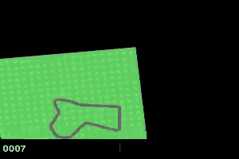
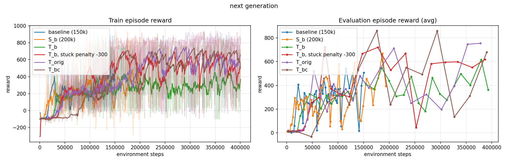
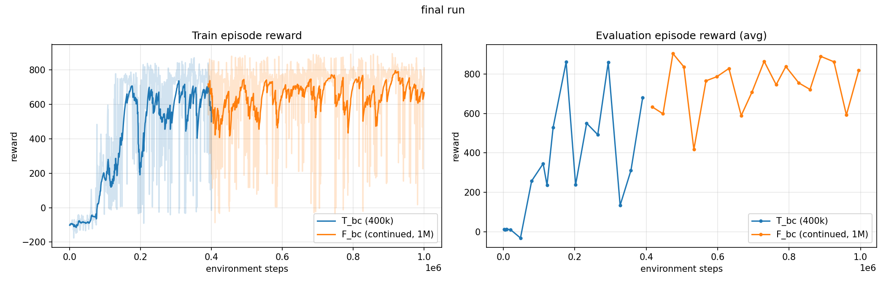

# Reinforcement Learning Project: TD3 for Vision-Based Continuous Control

This project implements **TD3 (Twin Delayed DDPG)** in PyTorch and trains it on `CarRacing-v2`, a car-driving task
where the agent sees only the camera image. Its continuous action is **steer ∈ [-1, 1], gas ∈ [0, 1],
brake ∈ [0, 1]**.

The project has three parts:

1. An **ablation study** of TD3's three fixes to DDPG and of the exploration-noise level.
2. **Reward shaping** computed from the camera image.
3. Several training-pipeline improvements. Together they raised the average score on 20 tracks from
   **578 to 865**.

<p align="center">
  
</p>
<p align="center">
  <em>The final model drives a full lap on a held-out track (seed 3128): 897 steps, score 910. Shown at real
  speed from the agent's top-down view. <a href="media/final_lap_seed3128.mp4">Original video (MP4)</a></em>
</p>

## Headline result

All scores below come from one deterministic game (no exploration noise) on each of 20 tracks (seeds 100–119).
Training and the evaluations during training draw random tracks, so this fixed set was set aside only for
comparing checkpoints. The score is the original environment reward: about +1000 for a full lap, minus 0.1 per
frame.

| Model | Mean ± std | Min | Games ending before 400 steps |
|---|---:|---:|---:|
| **Final model** (stage 5, step 888,858) | **864.9 ± 61.2** | 640.7 | 0 / 20 |
| Baseline TD3 (150k steps, final checkpoint) | 578.2 ± 236.7 | 149.9 | 4 / 20 |
| Baseline TD3 (150k steps, best checkpoint) | 626.0 ± 204.8 | 230.1 | 2 / 20 |

A full lap scores about 919–934, so the final model completes nearly every track. It is also much more consistent:
its standard deviation is about a quarter of the baseline's.

> **Selection bias:** the final model is the best of 25 checkpoints, ranked on these same 20 tracks, so its true
> mean is probably a little lower than 864.9. The baseline checkpoints were among those 25 and were evaluated the
> same way.

## Highlights

- **TD3 from scratch**: clipped double-Q learning, delayed actor and target updates, target policy smoothing,
  and soft (Polyak) target updates.
- **Vision-based control**: 4 stacked 96×96 grayscale frames go into a CNN actor and a CNN critic.
- **Ablation switches**: each TD3 component can be turned off on its own, so its effect can be measured.
- **Reward shaping from pixels**: penalties computed from the share of grass pixels under the car, steering
  changes, and speed while steering.
- **Training-pipeline improvements**:
  - a replay buffer on the GPU
  - resumable training
  - a "stuck" rule against a parking local optimum
  - a schedule that gradually relaxes the brake and throttle limits
  - noise decay
- **Fair checkpoint selection**: a script re-evaluates checkpoints in parallel on a common set of held-out tracks,
  instead of trusting the noisy scores recorded during training.

## Method

| Component | Implementation |
|---|---|
| Actor | 6 conv layers (ELU, max-pool) → MLP with LayerNorm → `tanh`, rescaled to the valid range of each action dimension |
| Critic (×2) | Same conv encoder for the state, an MLP for the action, concatenated → MLP → Q(s, a) |
| Target | `y = r + γ (1 − done) · min(Q1'(s', ã), Q2'(s', ã))`, where `ã = clip(μ'(s') + clip(ε, −c, c))` |
| Actor update | Every `update_freq` critic updates, maximize `Q1(s, μ(s))` |
| Exploration | Gaussian noise. The brake noise is scaled to match the brake's narrow output range |
| Environment wrapper | Grayscale conversion, 4-frame stacking, and road/grass pixel counting in a 24×20 window under the car |

Base hyperparameters: γ = 0.99, τ = 0.005, batch size = 32, actor and critic learning rate = 4.5e-5,
`update_freq` = 2, target-smoothing σ = 0.2 (clip 0.5).

## Development stages

Every run uses a **single random seed**. During training, each evaluation averages 10 random tracks and is noisy:
two evaluations in a row can differ by hundreds of points. Run names match the plots in `results/`.

| Stage | Runs | Steps | What changed | Last eval during training |
|---|---|---:|---|---:|
| 1. Baseline | `baseline` | 150k | Full TD3, replay buffer 5k | 508 |
| 2. Ablations and reward shaping | `single_q`, `delay1`, `custom_b`, … | 150k | One change at a time (see below) | 38–537 |
| 3. Action-limit schedule | `S_orig`, `S_b`, `S_bc` | 200k | Brake and throttle limits relaxed over training; noise σ 0.3 → 0.01 | 172–393 |
| 4. Larger buffer and stuck rule | `T_orig`, `T_b`, `T_b_p300`, `T_bc` | 400k | Stage 3 + 50k replay buffer on the GPU + stuck rule | 362–755 |
| 5. Final run | `F_bc` | 400k → ~1M | Resumed from `T_bc`; 150k replay buffer on the GPU | 819 |

What each stage taught us:

- **Stage 3 made things worse.** The original action mapping caps the brake at 0.03 and keeps the throttle at 0.1
  or more. Relaxing these limits let the agent learn to **park**. Standing still costs only −0.1 per frame, while
  leaving the road costs −100, so stopping became a safe local optimum. Evaluation scores went negative at those
  checkpoints.
- **Stage 4 added the stuck rule.** If the car stays below a speed threshold for 50 steps, the episode ends with
  the same −100 penalty as leaving the road. In the second half of stage-4 training, no evaluation score went
  negative, which is the sign of parking. Stage 4 also changed the
  buffer size and the evaluation interval at the same time, so its gain cannot be credited to one change.
- **Stage 5 continued the best stage-4 run.** That was `T_bc`, which uses the custom B+C reward. It ran to about
  1M steps with a 3× larger buffer. Evaluation became more stable: most evaluations fell between about 700 and 860.

Re-evaluating 25 checkpoints from all stages on the 20 held-out tracks showed that all six best checkpoints came
from the B+C reward runs (`T_bc` and `F_bc`). It also showed that the score at the end of a run can be misleading.
For example, the `F_bc` checkpoint at step 960k averaged only 454, while the one at 889k averaged 865.





## Ablation study (stage 2, 150k steps)

| Run | Change from the baseline | Best eval | Last eval |
|---|---|---:|---:|
| `baseline` | full TD3 | 541.3 | 508.0 |
| `single_q` | one critic, no clipped double-Q | 561.0 | 520.3 |
| `no_smoothing` | no target policy smoothing | 778.1 | 536.6 |
| `delay1` | `update_freq = 1` (no delay) | 659.5 | 38.0 |
| `delay4` | `update_freq = 4` | 596.7 | 246.2 |
| `sigma0.03` | exploration σ_max = 0.03 | 729.8 | 431.8 |
| `sigma0.3` | exploration σ_max = 0.3 | 701.8 | 162.7 |

- **Delayed policy updates showed the clearest trend.** Without a delay, the agent learns fastest at first, but
  late in training the evaluation score collapses to about 38. With `update_freq = 4` the agent is stable but
  learns slowly. The default of 2 sits between the two. In this code `update_freq` delays both the actor and the
  target networks, so their effects cannot be separated.
- **Twin Q-networks:** the single-critic run had lower training reward in the middle of training, which fits the
  overestimation explanation. The final scores of the two runs are similar.
- **Target policy smoothing** did not show a consistent benefit here. One possible reason is that σ = 0.2 is a
  large perturbation for steering, which is very sensitive in this task.
- **Exploration noise:** a larger σ found good behaviours earlier but was the least stable late in training.

Plots: [twin Q](results/1_twin_q.png) · [target smoothing](results/2_target_smoothing.png) ·
[delayed update](results/3_delayed_update.png) · [action noise](results/4_action_noise.png)

## Reward shaping

Every variant keeps the environment reward and the off-track rule (−100 and end of episode). `g` is the share of
grass pixels in the 24×20 window under the car, `steer` is the steering action, and `v` is the car's speed.

| Variant | Reward per step | Last eval at 150k |
|---|---|---:|
| original | `r_env` | 508.0 |
| v1 (`custom`) | `r_env − 1.0·g − 0.3·abs(steer_t − steer_{t−1})` | 346.7 |
| B (`custom_b`) | `r_env − 0.5·max(0, g − 0.3)` | 447.1 |
| B+C (`custom_bc`) | B `− 0.5·max(0, v − v_safe)/v_safe · abs(steer)`, with `v_safe = 41` | 440.9 |

- v1 was too harsh. Its grass penalty can reach 10× the per-frame time cost, and its jitter penalty discouraged
  the large steering inputs that sharp turns need.
- B softens the grass penalty: only the part of `g` above 0.3 is penalized.
- C adds a penalty for steering hard at high speed, to encourage slowing down before turns.
- At 150k steps with the original action limits, none of the shaped rewards beat the original one in the final
  evaluation.
- Once the brake limits were relaxed (stages 4–5), **B+C produced the best checkpoints**. The likely reason is
  that the agent can only act on a "slow down before turns" signal when it is able to brake hard. This is a
  hypothesis, not a tested result.

All coefficients are hand-picked and were not tuned. Plots: [stage 2](results/5_reward_function.png) ·
[stage 3](results/6_strong_setting_rewards.png)

## Limitations

- **One seed per setting.** Most differences between runs during training are within the noise. The
  re-evaluation on 20 tracks is more reliable, but it still compares single runs.
- **Stages 3–5 changed several settings at once**, so the source of the improvement cannot be fully separated.
- The thresholds and coefficients were chosen by hand: the stuck speed (5.0), `v_safe`, the reward coefficients,
  the buffer sizes and the noise schedules.
- For comparison, published CarRacing results such as World Models (906 ± 21 over 100 tracks) use different
  inputs and evaluation protocols, so they are not directly comparable.

## Repository structure

```
src/
├── main.py                       # training entry point and every command-line flag
├── td3_agent_CarRacing.py        # TD3 agent: action selection, critic and actor updates, action-limit schedule
├── base_agent.py                 # training and evaluation loop, target updates, checkpoints, resume, noise schedule
├── models/CarRacing_model.py     # CNN actor and critic
├── environment_wrapper/
│   └── CarRacingEnv.py           # preprocessing, frame stacking, off-track and stuck rules, reward variants
├── replay_buffer/replay_buffer.py  # preallocated uint8 ring buffer on the GPU (about 74 KB per transition)
├── select_model.py               # re-evaluate checkpoints on common tracks in parallel and rank them
├── plot_results.py               # TensorBoard logs → comparison plots and summary.csv
└── demo.py                       # run a checkpoint and record one video per track
results/                          # plots for every stage and summary.csv
media/                            # video of the final model on a held-out track
```

## Setup

The code uses the older `gym` 0.26 API (not `gymnasium`), so Python 3.10 is recommended. `gym[box2d]` needs
`swig` to build Box2D. A 150k-transition replay buffer needs about 11 GB of GPU memory. Use `--buffer` to make it
smaller.

```bash
pip install -r requirements.txt
```

## Usage

All commands are run from `src/`. On a headless machine (for example Colab), set `SDL_VIDEODRIVER=dummy` first.

```bash
# stage 1–2: baseline and ablations (150k steps each)
python main.py --logdir log/CarRacing/baseline/ --steps 150000
python main.py --no-twin                --logdir log/CarRacing/single_q/      --steps 150000
python main.py --no-smoothing           --logdir log/CarRacing/no_smoothing/  --steps 150000
python main.py --update-freq 1          --logdir log/CarRacing/delay1/        --steps 150000
python main.py --sigma-max 0.3          --logdir log/CarRacing/sigma0.3/      --steps 150000
python main.py --reward-mode custom_b   --logdir log/CarRacing/custom_b/      --steps 150000

# stage 4: action-limit schedule + noise decay + 50k GPU buffer + stuck rule (400k steps)
python main.py --logdir log/CarRacing/T_bc/ --steps 400000 \
  --brake-final 0.15 --gas-floor-final 0.0 --ramp-start 80000 --ramp-end 268000 \
  --sigma-max 0.3 --sigma-decay-steps 400000 \
  --buffer 50000 --eval-interval 40 --stuck-speed 5.0 --stuck-steps 50 \
  --reward-mode custom_bc --speed-safe 41.0

# stage 5: continue T_bc to 1M steps with a 150k buffer (copy T_bc/state.pth into F_bc/ first)
python main.py --logdir log/CarRacing/F_bc/ --steps 1000000 --resume \
  --brake-final 0.15 --gas-floor-final 0.0 --ramp-start 80000 --ramp-end 268000 \
  --sigma-max 0.05 --sigma-decay-steps 1000000 \
  --buffer 150000 --min-buffer 20000 --eval-interval 40 --stuck-speed 5.0 --stuck-steps 50 \
  --reward-mode custom_bc --speed-safe 41.0
```

`--speed-safe` sets the speed above which hard steering is penalized. A starting point is about half of the car's
top speed on a straight, which the wrapper reports as `info["speed"]`.

Plot the runs, select a checkpoint and record videos:

```bash
python plot_results.py --logroot log/CarRacing        # writes log/CarRacing/plots/*.png and summary.csv

# re-evaluate the top-3 and last-2 checkpoints of each run on 20 held-out tracks, 2 processes
python select_model.py --runs F_bc,T_bc,T_orig,T_b_p300,baseline --top 3 --last 2 --seeds 100-119 --workers 2

python demo.py --model log/CarRacing/F_bc/<checkpoint>.pth --seed 100 --episodes 5 --name final
```

Checkpoints are saved as `model_<step>_<eval score>.pth`, and the full training state as `state.pth` (used by
`--resume`). Each checkpoint stores the brake and throttle limits it was trained with, and these are restored when
it is loaded. Checkpoints are not included in this repository.
